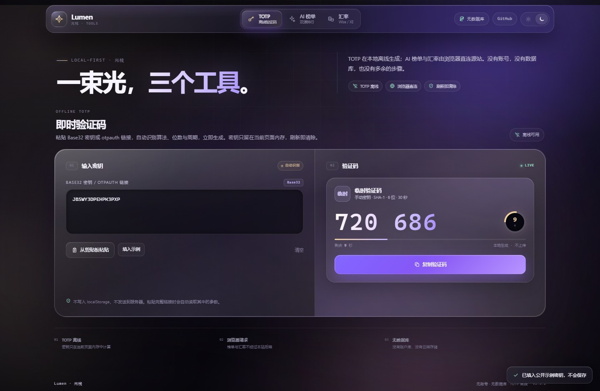
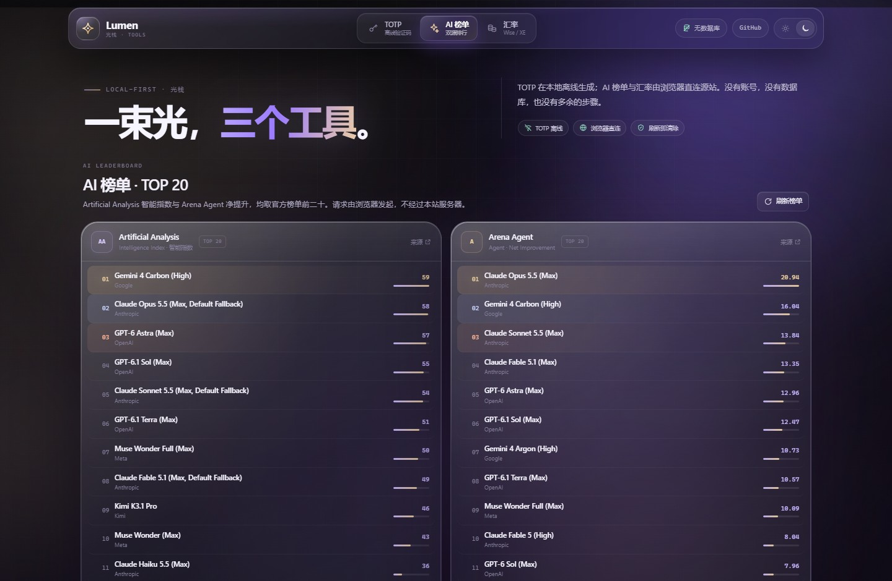
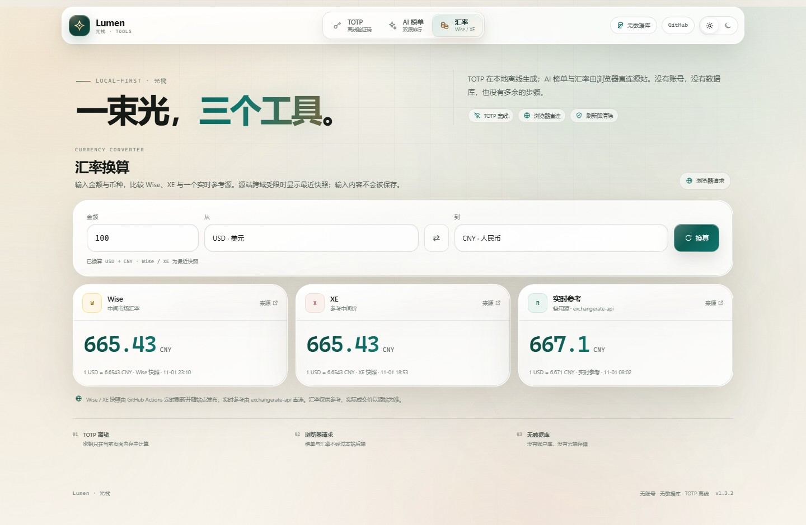
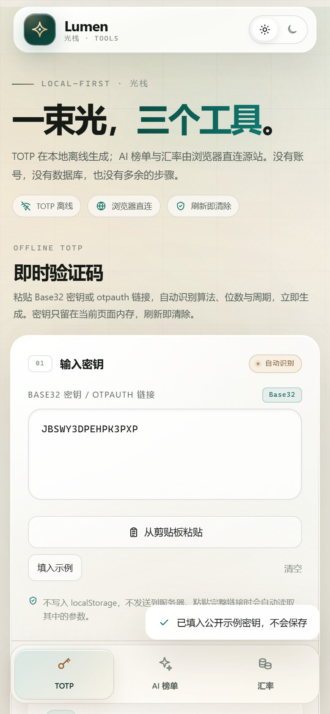

# Lumen · 光栈

> 三件随手小工具：**离线 TOTP**、**AI 模型榜单**、**Wise / XE 汇率换算**。
>
> 无账号、无数据库、无后端数据接口。打开网页即可用。

`TOTP 离线` · `AI 榜单` · `Wise / XE` · `无数据库` · `深/浅主题` · `MIT`

<p align="center">
  
</p>

<p align="center">
  
  &nbsp;&nbsp;
  
</p>

<p align="center">
  
</p>

## 三个工具

### 1. TOTP 验证码

- 粘贴 Base32 密钥或 `otpauth://` 链接，自动识别算法、位数与周期，验证码立即出现。
- 纯 Base32 密钥默认 SHA-1 / 6 位 / 30 秒；`otpauth://` 链接自动读取其中的参数。
- 点击复制；显示倒计时进度与圆形秒表。
- **不保存任何密钥**：输入只存在当前页面内存，刷新或关闭页面即清除。
- 完全离线，不需要网络。

### 2. AI 模型榜单

- **Artificial Analysis**：官方 Intelligence Index 排行榜前二十（默认 28 个公开模型中的真实排序），快照由 GitHub Actions 定时更新。
- **Arena Agent**：官方 Agent 排行榜 `Overall` 分类，按 Net Improvement 取前二十；浏览器通过官方 HuggingFace 数据集刷新，失败时使用快照。
- 显示模型、机构、分数和相对条形图；请求由浏览器发起。
- 数据源链接在每张榜单卡片右上角。

### 3. 汇率换算

- 输入金额、来源币种和目标币种，一键换算，支持常用 30 种货币。
- **Wise** 与 **XE** 使用最近快照；Wise 快照由 GitHub Actions 定时刷新，XE 因 WAF 限制保留最近快照。
- 额外提供 **exchangerate-api 实时参考**，由浏览器直连，弥补源站被拦截时无法换算的问题。
- 交换币种、输入金额会自动更新；结果卡片会标注“快照 / 实时”和更新时间。
- 汇率仅供参考，实际成交价以源站为准。

## 数据来源

| 数据 | 来源 | 获取方式 |
| --- | --- | --- |
| AI 榜单 · Artificial Analysis | [artificialanalysis.ai](https://artificialanalysis.ai/zh/models#intelligence) | GitHub Actions 定时刷新官方 Intelligence 榜前二十 |
| AI 榜单 · Arena Agent | [arena.ai](https://arena.ai/leaderboard/agent) | 浏览器读取官方 `lmarena-ai/leaderboard-dataset`（agent/latest），失败时回退快照 |
| 汇率 · Wise | [wise.com](https://wise.com/zh-cn/currency-converter/) | GitHub Actions 定时刷新 USD 基准快照，交叉换算 |
| 汇率 · XE | [xe.com](https://www.xe.com/zh-cn/currencyconverter/) | 内置 USD 基准快照，交叉换算 |
| 汇率 · 实时参考 | [exchangerate-api.com](https://www.exchangerate-api.com/) | 浏览器直连，CORS 可用 |

> 源站可能随时调整页面结构、CORS 策略或反爬规则。站点会优先显示已有快照，并在 UI 上标注数据时间；不会伪装成实时数据。

## 隐私与安全

- **没有账号系统**：不需要注册、登录、邮箱或手机号。
- **没有数据库**：Cloudflare Worker 只分发静态资源，不接收、不保存任何数据。
- **TOTP 密钥不离开页面内存**：不写 `localStorage`、不发网络请求；页面刷新即清空。
- 主题偏好（深色 / 浅色）是唯一写入 `localStorage` 的内容；TOTP 密钥从不写入。
- 界面支持深色与浅色两套液态玻璃主题，右上角可随时切换。
- 榜单/汇率请求从**你的浏览器**发出，不经过本站 Worker；源站限制跨域时会尝试公共 CORS 代理，或继续使用内置快照。
- 严格 CSP、禁止被嵌入、禁止搜索引擎索引；无统计脚本、无外链字体、无广告。
- 本项目不是密码管理器，也不保存密码、助记词或私钥。

## 本地运行

在仓库根目录运行：

```bash
python -m http.server 4173 --directory public
```

然后打开 `http://localhost:4173`。

本地静态服务器没有后端接口；AI/汇率会直接请求官方榜单接口/数据集或公开汇率 API，或使用内置快照。

## 部署到 Cloudflare Workers

这个项目是 **Workers 静态资源 + 一个只返回 ASSETS 的 Worker**，不是 Pages Functions，也不需要 KV。

1. 确认 Cloudflare Dashboard 中的 Worker 名称是 `authenticator`（与 `wrangler.jsonc` 的 `name` 一致）。
2. 把仓库连接到这个 Worker 的 Git 构建，Deploy command 保持 `npx wrangler deploy`。
3. 推送 `main`，Cloudflare 会自动构建并部署。
4. 自定义域名保持绑定在同一个 Worker 上即可，不需要迁移。

`wrangler.jsonc` 的关键配置：

```jsonc
{
  "name": "authenticator",
  "main": "worker/index.js",
  "compatibility_date": "2026-10-01",
  "assets": {
    "directory": "./public",
    "binding": "ASSETS"
  }
}
```

`worker/index.js` 只做一件事：返回 `env.ASSETS.fetch(request)`。如果你 fork 了项目，需要把 `name` 改成你自己的 Worker 名称。

## 目录结构

```text
public/
├── index.html                 # 工具页
├── assets/
│   ├── styles.css             # 深/浅色液态玻璃界面与布局
│   ├── boot.js                # 启动前应用已保存的主题
│   ├── core.js                # Base32 / TOTP / otpauth 解析
│   ├── data.js                # 榜单 + 汇率数据层
│   ├── app.js                 # Tab、TOTP、主题、复制
│   └── icon*.png / .svg       # 品牌与 PWA 图标
├── data/
│   ├── aa-snapshot.json       # Artificial Analysis 快照
│   ├── arena-snapshot.json    # Arena 快照（回退）
│   ├── wise-snapshot.json     # Wise USD 基准快照
│   └── xe-snapshot.json       # XE USD 基准快照
├── manifest.webmanifest
├── sw.js                      # 离线缓存（静态资源 + 快照）
├── _headers                   # Cloudflare 安全响应头
└── robots.txt
worker/
└── index.js                   # 仅返回静态资源
scripts/
└── refresh-data.mjs           # GitHub Actions 定时抓取快照
.github/workflows/
└── refresh-data.yml           # 每 6 小时更新榜单 / 汇率快照
wrangler.jsonc
docs/                          # README 截图
LICENSE
```

## TOTP 计算

- 算法：RFC 6238 TOTP + RFC 4648 Base32。
- 支持 `otpauth://totp/...`，自动读取 issuer、account、secret、algorithm、digits、period。
- 所有计算使用浏览器 Web Crypto，页面内完成。
- 不存储任何密钥；关闭页面或刷新即清除。

## 数据快照说明

- `public/data/*.json` 是普通静态 JSON，不是数据库。
- Artificial Analysis / Arena Agent / Wise 的快照由 `.github/workflows/refresh-data.yml` 每 6 小时刷新，并显示 `updatedAt`。
- XE 对数据中心 IP 返回 WAF 403，无法在 Actions 中稳定抓取；页面保留最近快照并明确标注。
- Arena Agent 排名来自官方 `lmarena-ai/leaderboard-dataset` 的 `agent/latest` 配置；浏览器优先读取该数据集，失败时使用快照。
- 实时参考汇率来自 `open.er-api.com`，每次打开页面最多请求一次。
- 更新快照后需要同步修改 `sw.js` 中的 `VERSION`（当前 `1.3.2`），避免手机端命中旧缓存。

## 已知限制

- 源站 CORS / Cloudflare WAF 可能阻止浏览器直连，因此 Wise/XE 使用快照，Artificial Analysis 使用快照。
- 公共 CORS 代理并不稳定；代理失败时不会让工具空白，而是保留快照。
- TOTP 只是临时查看工具，不是账户保险库：刷新后不保留任何密钥。
- 剪贴板可能被其他应用读取；复制验证码后建议覆盖剪贴板。
- 网页无法防御已被控制的设备、恶意扩展或键盘记录器。
- 汇率数据只作信息参考，不构成金融建议。

## 自动更新数据

GitHub Actions 每 6 小时运行一次 `node scripts/refresh-data.mjs`：

- 抓取 Artificial Analysis 官方 Intelligence 榜前 20 与 Arena Agent 官方数据集前 20；
- 逐项读取 Wise USD 基准汇率；
- 使用仓库所有者身份提交（`Quest123666`），不引入额外贡献者；
- 仅在 `public/data` 有变化时提交，推送后由 Cloudflare 自动部署。

也可以手动触发：Actions → **Refresh data snapshots** → Run workflow。

## 版本缓存

发布修改后请同步更新：

- `public/index.html` 中的所有 `?v=1.3.2`
- `public/sw.js` 中的 `VERSION` 和 `PRECACHE`
- 如果更新了快照文件，增加 `sw.js` 版本并重新部署

## License

[MIT](LICENSE) © 2026 Quest123666
