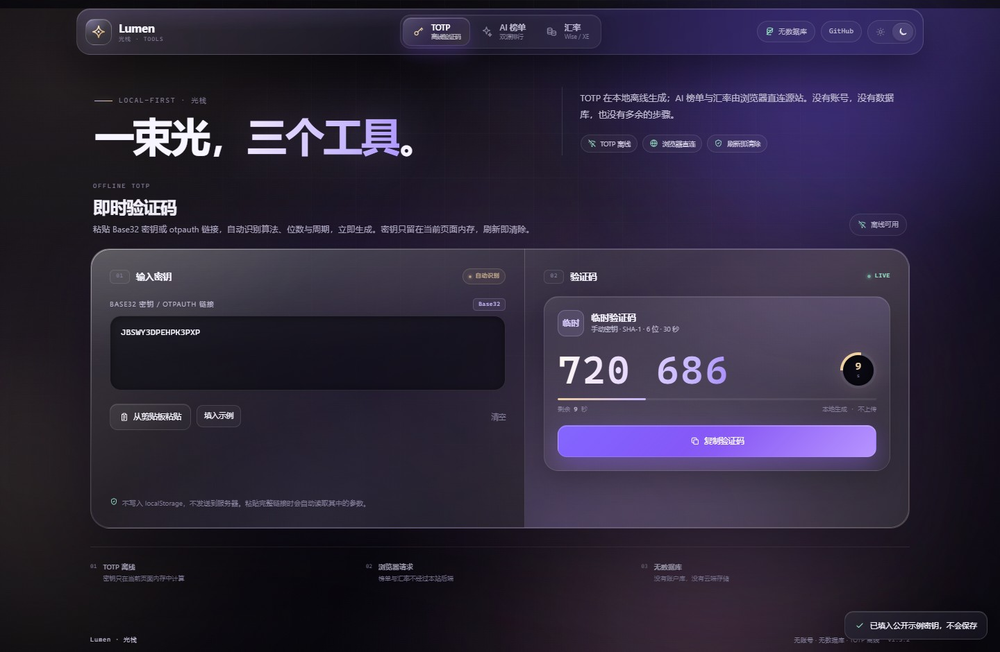
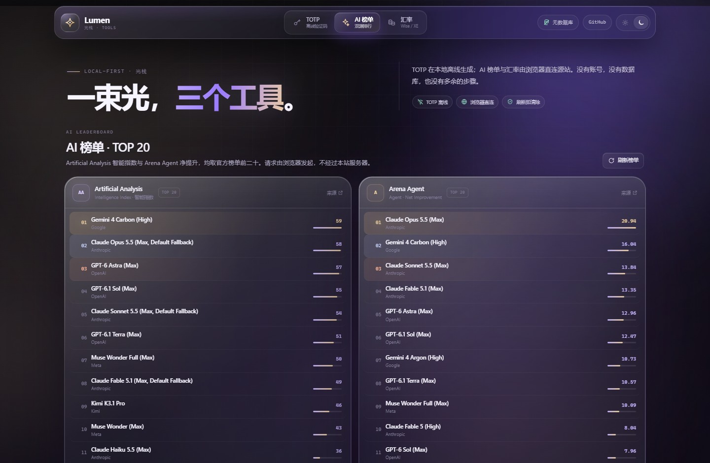
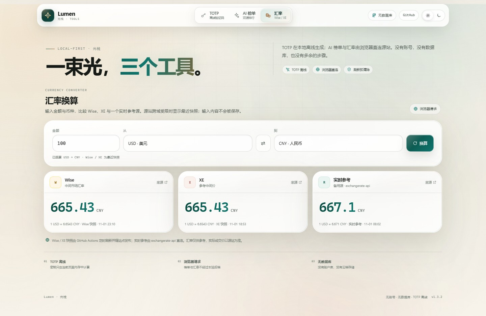
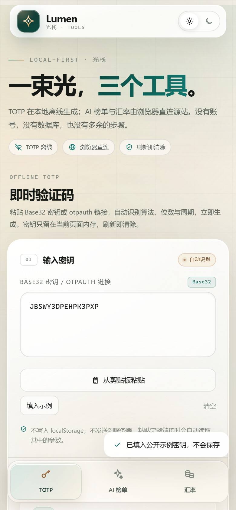

# Lumen · 光栈

> 四件随手小工具：**离线 TOTP**、**三源 AI 榜单**、**汇率换算与走势**、**TIOBE 语言榜**。
>
> 无账号、无数据库、无后端数据接口。打开网页即可用。

`TOTP 离线` · `AI 榜单` · `汇率走势` · `TIOBE` · `无数据库` · `深/浅主题` · `MIT`

<p align="center">
  
</p>

<p align="center">
  
  &nbsp;&nbsp;
  
</p>

<p align="center">
  
</p>

## 四个工具

### 1. TOTP 验证码

- 粘贴 Base32 密钥或 `otpauth://` 链接，自动识别算法、位数与周期，验证码立即出现。
- 纯 Base32 密钥默认 SHA-1 / 6 位 / 30 秒；`otpauth://` 链接自动读取其中的参数。
- 点击复制；显示倒计时进度与圆形秒表。
- **不保存任何密钥**：输入只存在当前页面内存，刷新或关闭页面即清除。
- 完全离线，不需要网络。

### 2. AI 榜单

- **Artificial Analysis**：官方 Intelligence Index 排行榜前二十（官方公开模型中的真实排序），快照由 GitHub Actions 定时更新。
- **Arena Agent**：官方 Agent 排行榜 `Overall` 分类，按 Net Improvement 取前二十；浏览器通过官方 HuggingFace 数据集刷新，失败时使用快照。
- **OpenRouter 调用量**：官方本周 LLM Leaderboard 前十，按 tokens processed 排序，显示环比涨跌。
- 显示模型、机构、分数和相对条形图；榜单快照每 6 小时生成，Arena 优先读取官方数据集。
- 数据源链接在每张榜单卡片右上角。

### 3. 汇率换算与走势

- 输入金额、来源币种和目标币种，一键换算，支持常用 30 种货币。
- **Wise** 快照由 GitHub Actions 每 6 小时刷新，点击“换算”会尝试实时刷新；**XE 参考价**来自 XE 官方中间市场汇率，快照每小时更新。
- **30 天 / 180 天 / 1 年走势图**：数据来自 XE 官方图表，近 35 天为小时级行情、更早为每日收盘；区间最高、最低与曲线取自同一组点，最高/最低点直接标注在曲线上，支持悬停查看任意日期。
- 汇率仅供参考，实际成交价以源站为准。

### 4. TIOBE 语言榜

- 展示 TIOBE Index 前二十：本月排名、评分、同比变化，以及去年排名。
- TIOBE 每月更新一次，快照由 GitHub Actions 定时同步。

## 数据来源

| 数据 | 来源 | 获取方式 |
| --- | --- | --- |
| AI 榜单 · Artificial Analysis | [artificialanalysis.ai](https://artificialanalysis.ai/zh/models#intelligence) | GitHub Actions 定时刷新官方 Intelligence 榜前二十 |
| AI 榜单 · Arena Agent | [arena.ai](https://arena.ai/leaderboard/agent) | 浏览器读取官方 `lmarena-ai/leaderboard-dataset`（agent/latest），失败时回退快照 |
| AI 榜单 · OpenRouter | [openrouter.ai](https://openrouter.ai/rankings#leaderboard-table) | GitHub Actions 抓取官方本周 Leaderboard 前十 |
| 汇率 · Wise | [wise.com](https://wise.com/zh-cn/currency-converter/) | GitHub Actions 定时刷新 USD 基准快照，交叉换算 |
| 汇率 · XE | [xe.com](https://www.xe.com/zh-cn/) | GitHub Actions 用无头 Chrome 读取官方汇率表与图表接口（XE 有 AWS WAF，普通请求会被拦截） |
| 语言榜 · TIOBE | [tiobe.com](https://www.tiobe.com/tiobe-index/) | GitHub Actions 定时抓取前二十 |

> 源站可能随时调整页面结构、CORS 策略或反爬规则。站点会优先显示已有快照，并在 UI 上标注数据时间；不会伪装成实时数据。

## 隐私与安全

- **没有账号系统**：不需要注册、登录、邮箱或手机号。
- **没有数据库**：Cloudflare Worker 只分发静态资源，不接收、不保存任何数据。
- **TOTP 密钥不离开页面内存**：不写 `localStorage`、不发网络请求；页面刷新即清空。
- 主题偏好（深色 / 浅色）是唯一写入 `localStorage` 的内容；TOTP 密钥从不写入。
- 界面支持深色与浅色两套液态玻璃主题，右上角可随时切换。
- Arena 与 Wise 实时刷新会从你的浏览器直接请求源站；其余榜单与汇率读取 GitHub Actions 生成的静态快照，不经过本站 Worker。源站限制跨域时会尝试公共 CORS 代理，或继续使用内置快照。
- 严格 CSP、禁止被嵌入、禁止搜索引擎索引；无统计脚本、无外链字体、无广告。
- 本项目不是密码管理器，也不保存密码、助记词或私钥。

## 本地运行

在仓库根目录运行：

```bash
python -m http.server 4173 --directory public
```

然后打开 `http://localhost:4173`。

本地静态服务器没有后端接口；Arena 与 Wise 实时刷新会直接请求官方接口，其余读取仓库内的快照。

需要本地刷新 XE 快照时，先安装驱动，再单独运行 XE 任务（可用 `XE_CHROME` 指定 Chrome 路径）：

```bash
npm install --no-save --no-package-lock playwright-core
node scripts/refresh-data.mjs --only=xe
```

## 部署到 Cloudflare Workers

这个项目是 **Workers 静态资源 + 一个只返回 ASSETS 的 Worker**，不是 Pages Functions，也不需要 KV。

1. 确认 Cloudflare Dashboard 中的 Worker 名称是 `authenticator`（与 `wrangler.jsonc` 的 `name` 一致）。
2. 把仓库连接到这个 Worker 的 Git 构建，Deploy command 保持 `npx wrangler deploy`。
3. 推送 `main`，Cloudflare 会自动构建并部署。
4. 自定义域名保持绑定在同一个 Worker 上即可，不需要迁移。

`wrangler.jsonc` 的关键配置：

```jsonc
{
  "name": "authenticator",
  "main": "worker/index.js",
  "compatibility_date": "2026-10-01",
  "assets": {
    "directory": "./public",
    "binding": "ASSETS"
  }
}
```

`worker/index.js` 只做一件事：返回 `env.ASSETS.fetch(request)`。如果你 fork 了项目，需要把 `name` 改成你自己的 Worker 名称。

## 目录结构

```text
public/
├── index.html                 # 工具页
├── assets/
│   ├── styles.css             # 深/浅色液态玻璃界面与布局
│   ├── boot.js                # 启动前应用已保存的主题
│   ├── core.js                # Base32 / TOTP / otpauth 解析
│   ├── data.js                # 榜单 + 汇率数据层
│   ├── app.js                 # Tab、TOTP、主题、复制
│   └── icon*.png / .svg       # 品牌与 PWA 图标
├── data/
│   ├── aa-snapshot.json       # Artificial Analysis 快照
│   ├── arena-snapshot.json    # Arena Agent 快照（回退）
│   ├── openrouter-snapshot.json # OpenRouter 调用量快照
│   ├── tiobe-snapshot.json    # TIOBE 语言榜快照
│   ├── wise-snapshot.json     # Wise USD 基准快照
│   └── xe-snapshot.json       # XE 汇率 + 一年历史快照
├── manifest.webmanifest
├── sw.js                      # 离线缓存（静态资源 + 快照）
├── _headers                   # Cloudflare 安全响应头
└── robots.txt
worker/
└── index.js                   # 仅返回静态资源
scripts/
└── refresh-data.mjs           # GitHub Actions 定时抓取快照
.github/workflows/
├── refresh-data.yml           # 每 6 小时更新榜单 / Wise 快照
└── refresh-xe.yml             # 每小时更新 XE 快照
wrangler.jsonc
docs/                          # README 截图
LICENSE
```

## TOTP 计算

- 算法：RFC 6238 TOTP + RFC 4648 Base32。
- 支持 `otpauth://totp/...`，自动读取 issuer、account、secret、algorithm、digits、period。
- 所有计算使用浏览器 Web Crypto，页面内完成。
- 不存储任何密钥；关闭页面或刷新即清除。

## 数据快照说明

- `public/data/*.json` 是普通静态 JSON，不是数据库。
- Artificial Analysis / Arena Agent / OpenRouter / TIOBE / Wise 的快照由 `.github/workflows/refresh-data.yml` 每 6 小时刷新；XE 由 `.github/workflows/refresh-xe.yml` 每小时刷新，并显示 `updatedAt`。
- Arena Agent 排名来自官方 `lmarena-ai/leaderboard-dataset` 的 `agent/latest` 配置；浏览器优先读取该数据集，失败时使用快照。
- XE 全站受 AWS WAF 的 JS 挑战保护，普通脚本与公共 CORS 代理都会被 202/403 拦截；因此刷新任务在 GitHub Actions 里用真实 Chrome 打开官方汇率表，再读取其图表接口，生成 USD 基准汇率与 365 天历史快照。
- 汇率走势直接读取 XE 快照，浏览器按交叉汇率计算任意币种组合，支持 30 天 / 180 天 / 1 年区间；近 35 天使用小时级行情，更早使用每日收盘。卡片当前价取 XE 图表的最新一点，与官网换算器一致。RUB 不在 XE 汇率表中，选到时会明确提示。
- 更新快照后需要同步修改 `sw.js` 中的 `VERSION`（当前 `1.5.5`），避免手机端命中旧缓存。

## 已知限制

- 源站 CORS / WAF 可能阻止浏览器直连，因此 Wise、XE、Artificial Analysis、OpenRouter、TIOBE 都使用快照；XE 快照依赖 GitHub Actions 的无头 Chrome，若任务失败界面会显示旧快照的更新时间。
- 公共 CORS 代理并不稳定；代理失败时不会让工具空白，而是保留快照。
- TOTP 只是临时查看工具，不是账户保险库：刷新后不保留任何密钥。
- 剪贴板可能被其他应用读取；复制验证码后建议覆盖剪贴板。
- 网页无法防御已被控制的设备、恶意扩展或键盘记录器。
- 汇率数据只作信息参考，不构成金融建议。

## 自动更新数据

GitHub Actions 分两个任务更新数据：

- `refresh-data.yml` 每 6 小时运行：抓取 Artificial Analysis 官方 Intelligence 榜前 20、Arena Agent 官方数据集前 20、OpenRouter 本周调用量前 10 与 TIOBE 前 20，并逐项读取 Wise USD 基准汇率；
- `refresh-xe.yml` 每小时运行：用无头 Chrome 读取 XE 汇率表与 365 天历史，生成 USD 基准快照；
- 使用仓库所有者身份提交（`Quest123666`），不引入额外贡献者；
- 仅在 `public/data` 有变化时提交，推送后由 Cloudflare 自动部署。

也可以手动触发：Actions → **Refresh data snapshots** 或 **Refresh XE snapshot** → Run workflow。

## 版本缓存

发布修改后请同步更新：

- `public/index.html` 中的所有 `?v=1.5.5`
- `public/sw.js` 中的 `VERSION` 和 `PRECACHE`
- 如果更新了快照文件，增加 `sw.js` 版本并重新部署

## License

[MIT](LICENSE) © 2026 Quest123666


